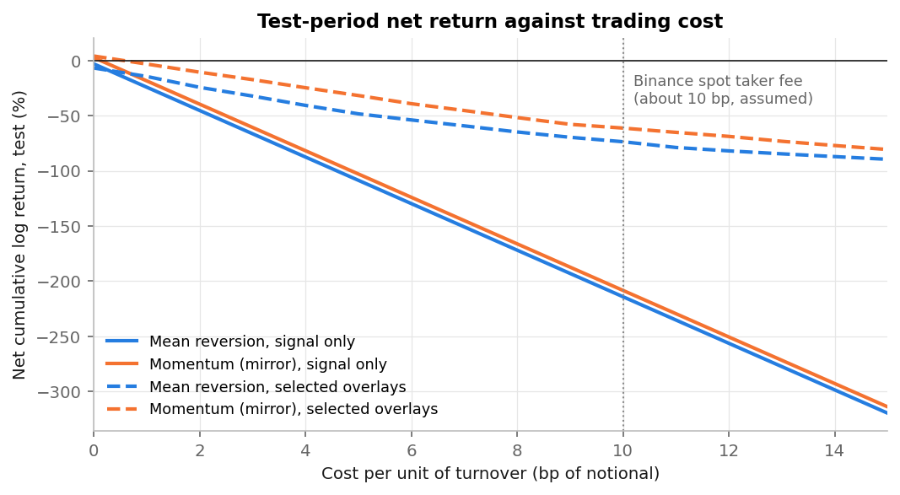

# Short-horizon mean reversion in BTC/USDT: 5-minute bars, 2024

I wanted to know whether a large 5-minute move in BTC/USDT tends to reverse over the next few bars. I used a rolling z-score of single-bar returns on Binance spot data for 2024, chose all parameters on the first 80% of the year, and tested once on the last 20% (Oct 19 to Dec 31).

It doesn't work. On the test period the signal lost 2.9% even before costs. The best setting in the whole training grid would only break even if fees were below 0.65 bp, and Binance charges about 10 bp. Flipping the signal into a momentum strategy gives +2.9% before costs on exactly the same trades, and it still loses heavily once fees are paid.



## Method

### Data

BTCUSDT spot 1-minute klines for January to December 2024 from Binance's public archive (data.binance.vision), aggregated to 5-minute bars: 105,408 bars, no missing minutes. `scripts/download_data.py` fetches the twelve monthly zip files and checks their published SHA-256 sums. The loader reads the official headerless CSV format, accepts millisecond (pre-2025) and microsecond (2025 onward) timestamps, and runs `validate_ohlcv` on load and again after resampling.

Returns do reverse slightly. The autocorrelations at lags 1 and 2 are $-0.013$ and $-0.018$, just outside the $\pm 0.006$ band expected for random data. That's the reason to test mean reversion, but the effect is tiny.

### Signal

For bar $t$ with log return $r_t$, the z-score is

$$
z_t = \frac{r_t - \bar{r}_{t,W}}{s_{t,W}},
$$

where $\bar{r}_{t,W}$ and $s_{t,W}$ are the mean and standard deviation of the last $W$ returns. The mean-reversion signal is

$$
s_t =
\begin{cases}
+1 & z_t < -k, \\
-1 & z_t > k, \\
0 & \text{otherwise.}
\end{cases}
$$

An optional exit band $e < k$ holds the position until $z_t$ relaxes past $-e$ (long) or $+e$ (short). The momentum signal is $-s_t$. The position for bar $t$ is set at the close of bar $t-1$.

Signals are computed on the full series and then split. They only use past bars, so this leaks nothing, and splitting first would leave the first $W$ bars of each period without a signal.

### Costs

Each unit of position change costs $c$. Entering a full position costs $c$, and flipping from $-1$ to $+1$ costs $2c$. I used $c = 10$ bp, roughly the Binance spot taker fee for a regular account without the BNB discount. VIP tiers, BNB payment and maker orders are cheaper. Spread (about 0.01 bp on BTCUSDT) and market impact aren't modelled. Every configuration breaks even below 1 bp, so the exact fee doesn't change the conclusion.

### Selection protocol

The year is split by time into train (Jan 1 to Aug 7, 60%), validation (Aug 7 to Oct 19, 20%) and test (Oct 19 to Dec 31, 20%).

1. On train, evaluate $W \in \lbrace 10, 20, 40 \rbrace$, $k \in \lbrace 1, 1.5, 2 \rbrace$ and exit band $e \in \lbrace \text{none}, 0.5, 0 \rbrace$ for the mean-reversion signal, and keep the highest net Sharpe at 10 bp. This gave $W = 40$, $k = 2$, $e = 0$.
2. On train, rank UTC hours by the selected signal's mean gross return. The top eight form a candidate session filter.
3. On validation, choose among 24 overlay combinations: session filter on or off, volatility target off / 0.10% / 0.13% / 0.16% per bar, daily stop off / 0.75% / 1%. The best was the session filter with a 1% daily stop.
4. On test, evaluate the selected signal with and without its overlays, in both directions, once.

### Overlays

Positions are capped at $\pm 1$, so there is no leverage. Volatility targeting multiplies the position by $\min(1, \sigma^{\ast}/\hat{\sigma}_t)$, where $\sigma^{\ast}$ is the target and $\hat{\sigma}_t$ is the standard deviation of the previous 96 returns. The scaler for bar $t$ only uses data up to bar $t-1$. Because of the cap it can only reduce exposure. On validation it sat at the cap on 32%, 56% and 73% of bars for the three targets.

The daily stop goes flat for the rest of the UTC day once that day's net return, after fees, falls to $-L$.

### Walk-forward

As a second check, 31 rolling windows of 60 training days and 10 test days cover Mar 1 to Dec 31. One run uses fixed parameters chosen in advance ($W = 20$, $k = 1.5$); the other re-selects $(W, k)$ on each training window by net Sharpe at 10 bp. The selector only sees the training window, and only the test windows are backtested.

## Results

Test block, 21,081 bars. Returns are cumulative log returns in percent. Turnover is $\sum_t \lvert p_t - p_{t-1} \rvert$ for positions $p_t$; entries counts new long or short positions, including flips. Break-even is gross return divided by turnover. Sharpe ratios are annualised with $365 \times 288$ bars per year, and the intervals are 95% moving-block bootstrap percentiles. Net figures use 10 bp per unit turnover.

| Variant | Gross | Net | Turnover | Entries | Break-even (bp) | Gross Sharpe [95% CI] | Net Sharpe |
|---|---:|---:|---:|---:|---:|---:|---:|
| Mean reversion, signal only | -2.87 | -214.1 | 2,112 | 1,056 | -0.14 | -0.6 [-4.6, 3.2] | -41.7 |
| Momentum (mirror), signal only | +2.87 | -208.3 | 2,112 | 1,056 | +0.14 | 0.6 [-3.2, 4.6] | -40.8 |
| Mean reversion, session filter + 1% stop | -11.91 | -73.5 | 616 | 308 | -1.93 | -5.5 [-9.7, -1.2] | -28.9 |
| Momentum (mirror), session filter + 1% stop | +5.47 | -61.1 | 666 | 333 | +0.82 | 2.0 [-2.2, 6.5] | -20.8 |
| Buy and hold | +31.65 | | | | | 3.0 | |

A net log return of $-214\%$ means the account ends at $e^{-2.14} \approx 0.12$, or 12% of starting capital.

The two signal-only rows mirror each other exactly: same turnover, opposite gross return. In both directions the gross Sharpe interval includes zero, so there is no measurable edge before costs, and whatever there is would be about seventy times smaller than the fee. Once the daily stop is added the rows no longer mirror, because the stop fires on different days for each direction. The session filter was chosen on train and made the mean-reversion version worse on test.

Net Sharpe ratios of -21 to -42 look extreme, but they're just what happens when a strategy pays 10 bp on about 29 units of turnover a day (14 entries) and earns almost nothing before costs. The break-even cost tells you more.

Walk-forward, Mar 1 to Dec 31, 10 bp:

| Method | Gross | Net | Turnover | Break-even (bp) | Net Sharpe [95% CI] |
|---|---:|---:|---:|---:|---:|
| Fixed $W = 20$, $k = 1.5$ | -2.60 | -2,122 | 21,198 | -0.01 | -89.9 [-93.6, -86.2] |
| Re-selected per window | -10.78 | -874 | 8,634 | -0.12 | -51.4 [-54.5, -48.0] |

The re-selected run chose $k = 2$ in all 31 windows ($W = 40$ in 20, $W = 10$ in 9, $W = 20$ in 2). At this fee level, picking the best net Sharpe mostly means picking the setting that trades least.

More figures are in `reports/figures/`: test equity curves for both directions (`equity_curves.png`), break-even cost across the training grid (`break_even_grid.png`), and training-block returns by hour (`hourly_returns.png`). `reports/summary.tex` is a LaTeX write-up of the same results generated by the report script; no PDF is committed. Full grids are in `reports/*.csv`, and more detail on the method is in [docs/methodology.md](docs/methodology.md).

## Limitations

- One asset, one year, one bar size. The test block was a strong uptrend (buy and hold +37%), and ten weeks of 5-minute bars is still a short sample for a Sharpe estimate.
- The cost model is linear. It ignores spread, impact, latency, partial fills and queue position. Trading only with limit orders would cut fees, but those orders tend to fill when the price is about to move against you, and that isn't modelled.
- Validation numbers were used to choose the overlays, so they are optimistic.
- The test period wasn't completely unseen. I chose the parameter grids, and decided to test this signal at all, after an earlier look at the full 2024 data. The three-way split stops direct selection on test data, but it can't undo that earlier look. The walk-forward grid has the same issue.
- I only tested one kind of signal, the z-score of a single bar's return. Mean reversion over longer horizons, in spreads between related assets, or conditional on order flow isn't covered.

## How to run

Requires [uv](https://docs.astral.sh/uv/). The project is pinned to Python 3.12 (`.python-version`); pyarrow 22 has no wheels for newer interpreters.

```bash
uv sync                                         # environment, incl. dev tools
uv run python scripts/download_data.py          # 12 monthly zips, ~25 MB, into data/raw/
uv run python scripts/run_full_pipeline.py      # build 5-minute bars, run the protocol, print test results
uv run python scripts/make_summary_report.py    # figures, CSV tables, reports/summary.tex
uv run pytest                                   # unit tests
```

To re-execute the notebooks:

```bash
uv run jupyter nbconvert --to notebook --execute --inplace notebooks/*.ipynb
```

The notebooks follow the protocol in order: `01` data, `02` the signal on train and validation, `03` the training grid and cost sensitivity, `04` overlays on validation and the single test evaluation, `05` walk-forward. They call the same code as the scripts (`src/btc_research/study.py`), so the numbers match.

```
src/btc_research/   data_loader, validation, preprocess, signals, backtest, metrics,
                    param_search, walk_forward, study (the protocol)
scripts/            download_data, run_full_pipeline, make_summary_report
notebooks/          01-05, executed
reports/            figures/*.png, result tables (*.csv), summary.tex
tests/              pytest suite
docs/               methodology notes
```

This repository is research code, not trading advice.
